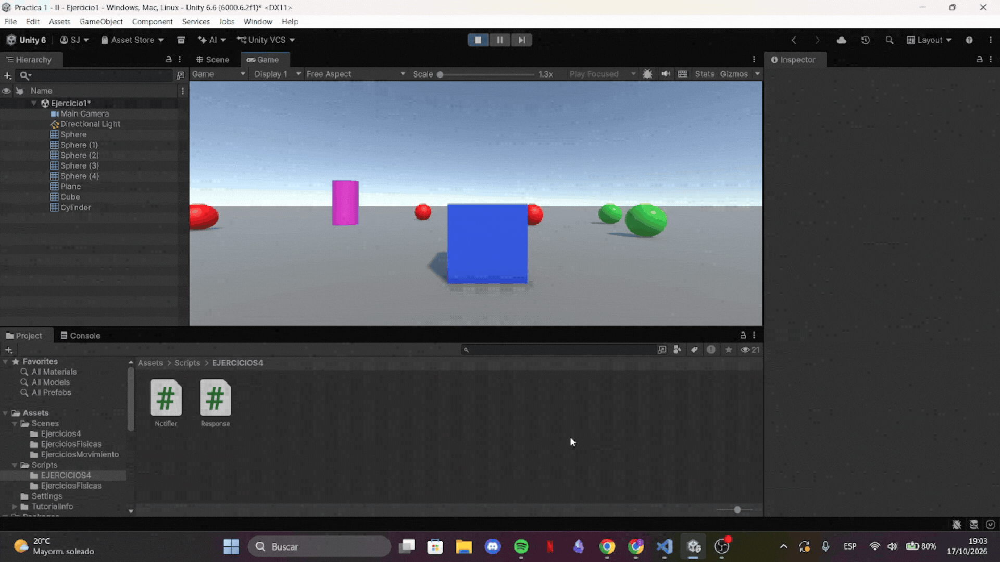
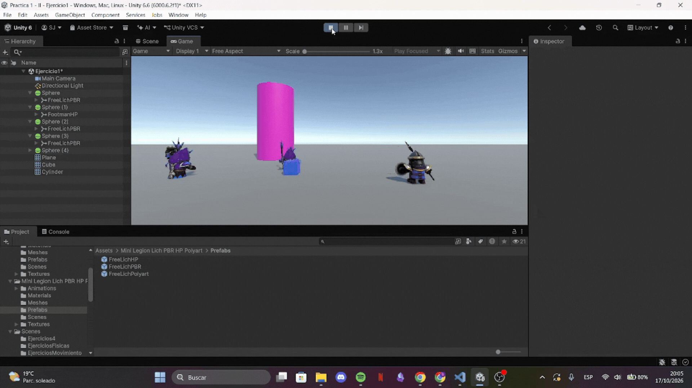
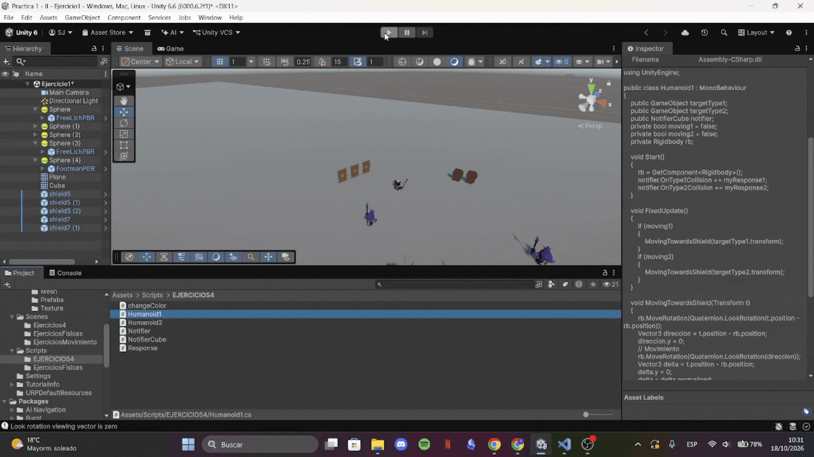
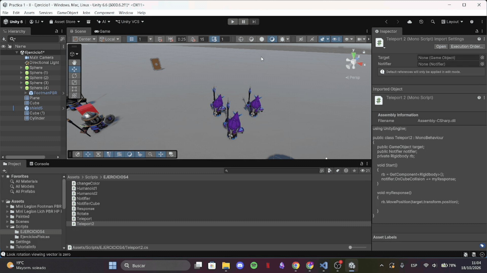
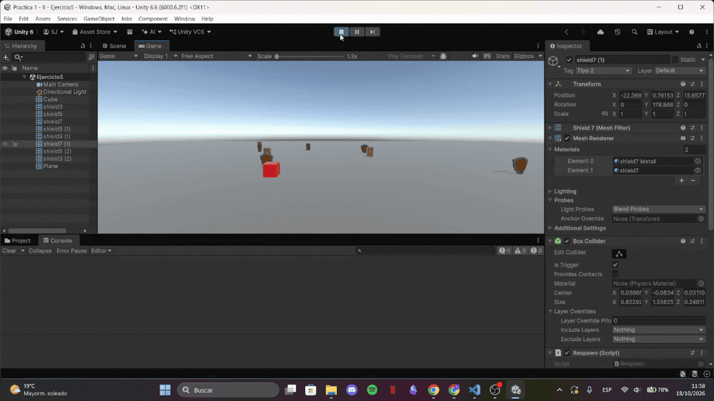
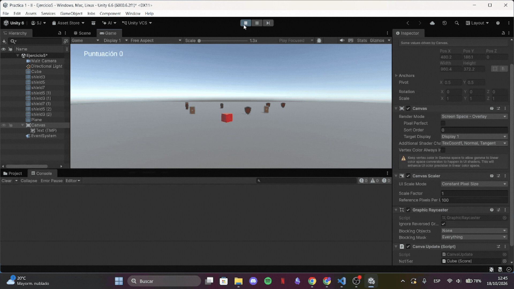
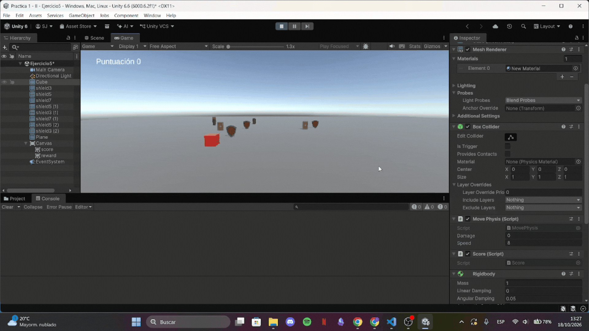
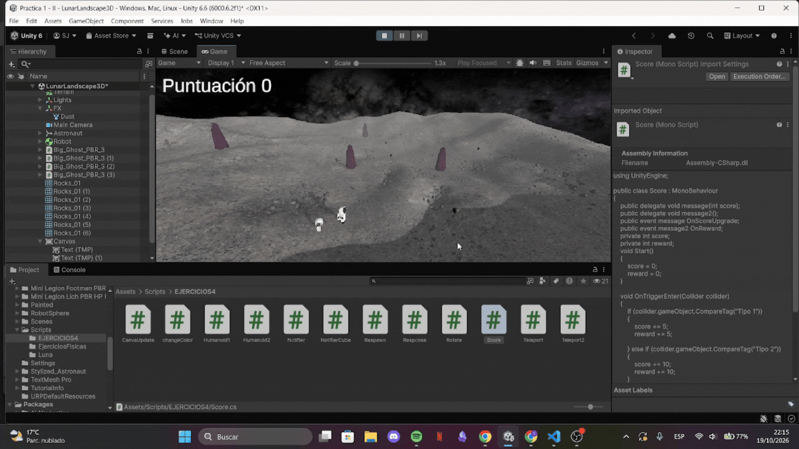

# Practica3_II
Práctica 4 de Interfaces Inteligentes

* **Autor:** Sonia Frías Jiménez 
* **ALU** alu0101492513@ull.edu.es
* **Versión de Unity:** 6.6

  
<b>Índice de ejercicios</b>

  1. [Ejercicio 1](#Ejercicio-1)
  2. [Ejercicio 2](#Ejercicio-2)
  3. [Ejercicio 3](#Ejercicio-3)
  4. [Ejercicio 4](#Ejercicio-4)
  5. [Ejercicio 5](#Ejercicio-5)
  6. [Ejercicio 6](#Ejercicio-6)
  7. [Ejercicio 7](#Ejercicio-7)
  8. [Ejercicio 8](#Ejercicio-8)
  9. [Ejercicio 9](#Ejercicio-9)

# Ejercicio 1
Para la escena se han creado cinco esferas (tres de color rojo y dos de color verde). El ejercicio consiste en disparar un evento cuando el cubo colisiona con el cilindro; para ello, se han creado dos scripts correspondientes al notificador y a los suscriptores:

* Notificador: cuando detecta la colisión, dispara el evento.
* Suscriptores: cuando reciben el mensaje, una variable booleana pasa a true, lo que activa el movimiento de cada esfera hacia el objetivo asignado.

Las esferas rojas tienen como objetivo alguna esfera verde, mientras que las esferas verdes tienen como objetivo el cilindro.

### Prueba

# Ejercicio 2
Se sustituyen las esferas por los assets correspondientes. Además, se modifica ligeramente el script de los suscriptores para que, al desplazarse, miren en la dirección adecuada del movimiento.

### Prueba

# Ejercicio 3
Para este ejercicio se han implementado tres scripts distintos:

1. Asignado al cubo: cuando colisiona contra alguno de los humanoides, envía un evento acorde al tipo de humanoide que lo activó.
2. Asignado a los humanoides de tipo 1: escuchan los eventos y responden de forma adecuada según el tipo de evento recibido.
3. Asignado a los escudos: permite cambiar su color, para lo cual previamente se modificó el material con el fin de percibir dicho cambio.

### Prueba

# Ejercicio 4
Para este ejercicio se reutiliza el script notificador del primer ejercicio y se crean otros dos adicionales, uno para cada tipo de humanoide, que implementan la tarea solicitada (rotación o teletransporte).

### Prueba

# Ejercicio 5
En este caso se crea una escena nueva con el cubo como personaje y una serie de escudos. Se implementan 2 scripts:
1. Asignado al cubo para controlar la puntuación cuando ocurre una colisión.
2. Asignado a los escudos para cambiar de posición cuando ocurre una colisión.

### Prueba

# Ejercicio 6
Para este ejercicio se modica el script Score para que envie un evento en lugar de escribir la puntuación por consola. Además, se crea un canva que está suscrito al notificador para actualizar el texto con la puntuación. 

### Prueba

# Ejercicio 7

### Prueba

# Ejercicio 8

### Prueba

# Ejercicio 9

### Prueba

